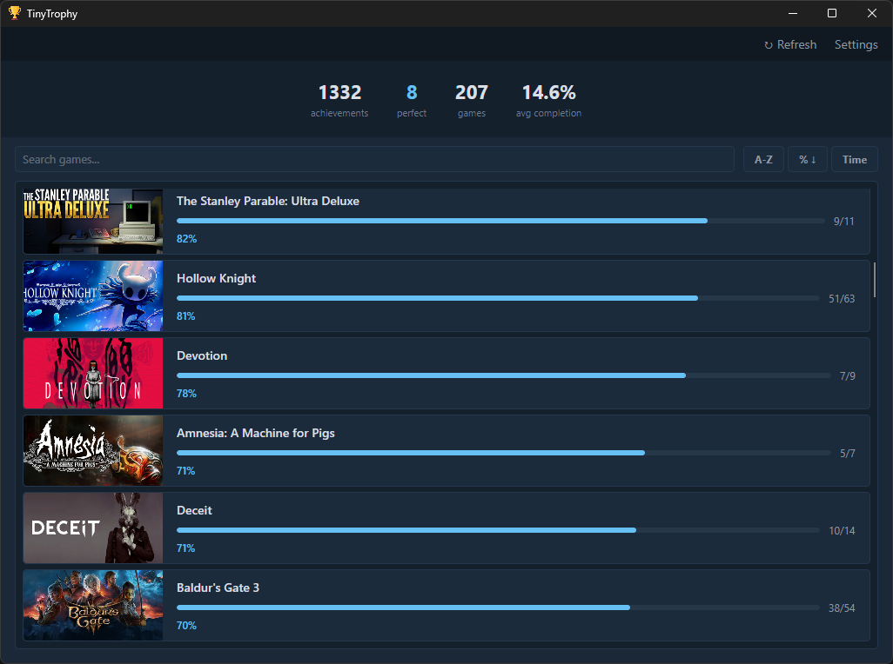
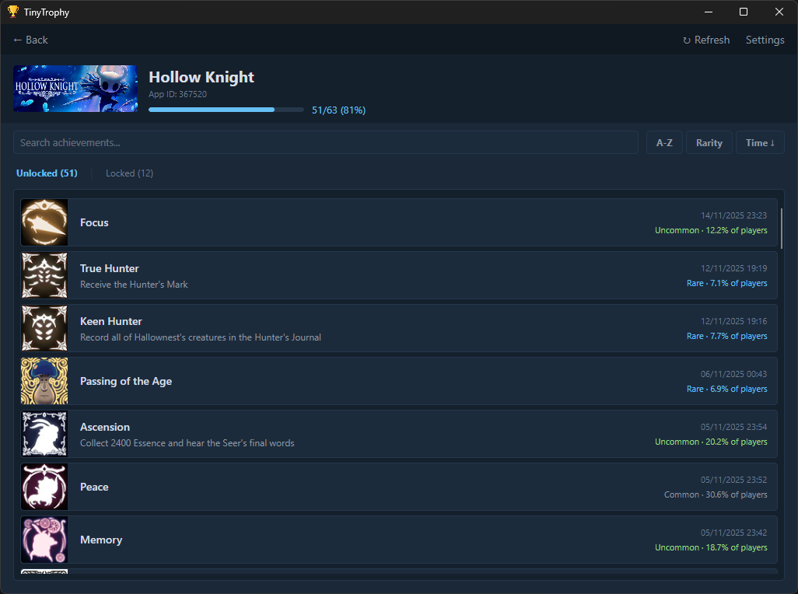

# Tiny Trophy

A lightweight achievement tracker that watches your games across Steam, Steam emulators and
ShadPS4 — all in a single, portable executable. Runs natively on **Windows** and **Linux**,
including Steam emulator achievements inside Proton/Wine prefixes.

<table>
	<td align="left">
		
	</td>
	<td align="left">
		
	</td>
</table>

## What Tiny Trophy gives you

| Capability | What it means in use |
|---|---|
| Every source in one list | Official Steam achievements, Steam emulator save files and ShadPS4 trophies are scanned, merged by game and shown together. |
| Real-time notifications | A desktop popup, with optional sound, appears the moment an achievement unlocks. |
| Live monitoring | Folder watchers pick up unlocks while a game runs and re-read only the game that changed. |
| A lightweight footprint | ~100 MB of RAM with the window open, ~10 MB while in the tray. Native Avalonia UI, no bundled browser engine. |
| One portable file | No installer and no runtime to pre-install; the published build is a single executable. |
| Auto-updates | Checks GitHub releases and lets you update in one click. |
| Linux and Proton | Resolves Windows-style save paths inside every configured Proton/Wine prefix. |

### The achievement you just unlocked

Notifications are raised from the same watcher that keeps the list current, so a popup never
arrives for an achievement the app will not show. Hidden achievements stay masked until they
unlock, and rarity is shown when Steam reports a global percentage or the trophy has a PS4 tier.

### Lightweight on purpose

Tiny Trophy is designed to stay out of your way while you game. It uses a native desktop toolkit —
no browser engine, no hidden background processes eating into your system resources.

- **~100 MB of RAM (~10 MB in the background)** leaves more memory for the game's textures, world
  streaming and frame pacing.
- **Minimal CPU usage** keeps the processor focused on the game rather than on rendering a tracker
  in the background.
- **No stutters or frame drops** while playing: scanning and enrichment run off the UI thread, and
  images are cached at the size they are drawn.

## Requirements and limits

- Windows 10/11 x64 or a modern x64 Linux distribution.
- The published executable is self-contained; building from source needs the .NET 10 SDK.
- Steam's official source needs a personal Steam Web API key and Steam ID. The emulator and
  ShadPS4 sources need neither.
- Only achievement files the app understands are read. A save format with no parser shows no
  achievements for that game.
- The app is single-instance and lives in the system tray; closing the window does not quit it.
- One scan runs at a time. A reload requested while a scan is running is queued, and metadata
  enrichment keeps the home list hidden until it finishes.

## Download

Grab the latest release from the [Releases](https://github.com/giovanni-bozzano/tiny-trophy/releases/latest)
page. No installation is needed — download and run.

## Getting started

1. Download the latest release.
2. Run **TinyTrophy.exe** (or `TinyTrophy` on Linux).
3. Follow the initial setup to configure your sources. Enter your Steam API key and Steam ID to
   track official achievements.
4. Right-click the tray icon to enable **Run on startup** and **Start minimized**.

## Supported sources

| Source | Description |
|--------|-------------|
| Steam (Official) | Your real Steam library via the Steam Web API |
| Steam (Emulator) | Achievement files from Steam emulators (see the list below) |
| ShadPS4 | PS4 trophies from the [ShadPS4](https://github.com/shadps4-emu/shadPS4) emulator |

### Supported Steam emulators

The following emulator folders are detected automatically on first launch:

| Emulator | Default path |
|----------|-------------|
| Goldberg | `%AppData%\Goldberg SteamEmu Saves` |
| GSE | `%AppData%\GSE Saves` |
| OnlineFix | `%CommonDocuments%\OnlineFix` |
| RUNE | `%CommonDocuments%\Steam\RUNE` |
| CODEX (AppData) | `%AppData%\Steam\CODEX` |
| CODEX (Public Documents) | `%CommonDocuments%\Steam\CODEX` |
| EMPRESS (AppData) | `%AppData%\EMPRESS` |
| EMPRESS (Public Documents) | `%CommonDocuments%\EMPRESS` |
| SmartSteamEmu | `%AppData%\SmartSteamEmu` |
| Anadius LSX | `%LocalAppData%\anadius\LSX emu\achievement_watcher` |
| SKIDROW | `%LocalAppData%\SKIDROW` |

### Custom folders

Add your own folders from Settings. Any folder that contains subfolders named by Steam AppID with
achievement files is picked up automatically. Each folder can be enabled or disabled individually;
default folders can be disabled but not removed.

### Linux and Proton

Tiny Trophy runs natively on Linux. Because emulator save paths are authored as Windows paths
(`%AppData%`, `%LocalAppData%`, etc.), they are resolved separately inside every Proton/Wine prefix
found under your configured **Proton/Wine Prefix Directories** (shown in Settings on Linux). The
following default prefix locations are detected automatically:

| Launcher | Default prefix directory |
|----------|--------------------------|
| Steam | `~/.steam/steam/steamapps/compatdata/*/pfx` |
| Steam (alternative) | `~/.local/share/Steam/steamapps/compatdata/*/pfx` |
| Steam (Flatpak) | `~/.var/app/com.valvesoftware.Steam/.steam/steam/steamapps/compatdata/*/pfx` |
| Steam (Flatpak alternative) | `~/.var/app/com.valvesoftware.Steam/.local/share/Steam/steamapps/compatdata/*/pfx` |
| Heroic Games Launcher | `~/Games/Heroic/Prefixes/*` |
| Lutris | `~/Games/*/*` |
| Bottles (Flatpak) | `~/.var/app/com.usebottles.bottles/data/bottles/bottles/*` |

Each `*` is resolved against every real (non-symlink) directory found on disk at that level. Prefix
directories can be added, removed, enabled or disabled from Settings, and the built-in directory
debug panel shows every candidate path a watched folder expands to and whether it exists.

## Why a Steam Web API key?

Tiny Trophy asks for your personal [Steam Web API key](https://steamcommunity.com/dev/apikey) to
fetch achievement names, descriptions, icons and global unlock percentages directly from Valve's
official `ISteamUserStats` API.

Using your own free key means:

- **Always up to date** — achievement data comes straight from Steam, including games released
  yesterday.
- **Reliable** — requests go directly to Valve under your own key, so another user's activity or
  rate limit cannot affect you.
- **Private and yours** — the key is stored locally and used only to talk to Valve on your behalf;
  Tiny Trophy has no server and never sees or transmits it anywhere else.
- **Free and quick** — generating a key takes less than a minute at
  [steamcommunity.com/dev/apikey](https://steamcommunity.com/dev/apikey).

## Build

Requirements: the [.NET 10 SDK](https://dotnet.microsoft.com/download), plus the platform C
toolchain NativeAOT needs.

```bash
git clone https://github.com/giovanni-bozzano/tiny-trophy.git
cd tiny-trophy
dotnet build TinyTrophy.slnx -c Debug
dotnet publish src/TinyTrophy.csproj -c Release -r win-x64
```

Replace `win-x64` with `linux-x64` to build for Linux. NativeAOT cannot cross-compile, so each
runtime identifier has to be published on its own OS. The output is a single executable in
`src/bin/Release/net10.0/<rid>/publish/`.

See [Build and publish](docs/BUILD.md) for prerequisites, outputs and troubleshooting, and
[Testing](docs/TESTING.md) for the test suite.

## How it works

Scanners read local achievement files and, when credentials are configured, the Steam Web API.
The achievement service merges duplicate games from different sources, and enrichers add Steam
names, icons, hidden flags and global percentages. One view model owns the merged list, its search,
filter and sort state and the profile totals; detail pages are refreshed from the same list.

Folder watchers run alongside the scan. They seed their known state from disk, debounce bursts of
file events, compare unlocks against that state and raise two kinds of events: a single game changed
(refresh it), or an achievement unlocked (show a notification). The UI thread receives both.

Settings, the Steam metadata cache, downloaded images and the update flag live under the
platform-appropriate app data directories. Writes are atomic, caches are disposable, and the app
trims freed memory when it hides to the tray.

## Documentation

| Guide | What it covers |
|---|---|
| [Build and publish](docs/BUILD.md) | Prerequisites, Debug build, run, NativeAOT publish and outputs |
| [Testing](docs/TESTING.md) | Test suite map, running tests and what needs a window or network |
| [Architecture](docs/architecture/README.md) | Components, data flow, threading, persistence and packaging |
| [Agent instructions](AGENTS.md) | Rules for changing code, tests and commits |

## Licensing

The repository is MIT-licensed; see [LICENSE](LICENSE). Achievement names, icons and global
percentages are fetched from Steam and remain subject to Valve's terms.

## Acknowledgements

Inspired by [Achievement Watcher](https://github.com/xan105/Achievement-Watcher) by xan105.
