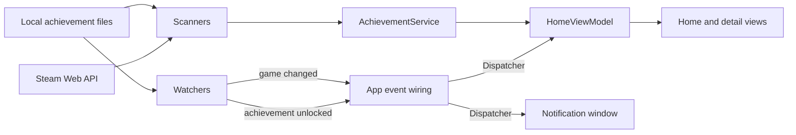

# Overview

[Architecture index](README.md) | [Documentation](../README.md)

Tiny Trophy is one Avalonia process. It scans achievement files and the Steam Web API, keeps one
merged game list, and watches the same files so unlocks arrive while a game runs. There is no
service, no background helper and no database.

## Components

| Component | Where | Responsibility |
|---|---|---|
| Entry point | `Program.cs` | Claims the single-instance mutex, extracts embedded natives, starts Avalonia |
| Application shell | `App.axaml.cs` | Window and tray, startup/shutdown order, event wiring, update check |
| Composition root | `Infrastructure/AppServices.cs` | Builds and owns settings, API, scanners, enrichers, watchers and view models |
| Scanners | `Infrastructure/Scanners/` | Turn each source into a list of `Game` objects |
| Parser | `Infrastructure/AchievementFileParser.cs` | Reads emulator save files in JSON, INI and binary forms |
| Enrichers | `Infrastructure/Enrichers/` | Add Steam names, icons, hidden flags and global percentages |
| Achievement service | `Infrastructure/AchievementService.cs` | Orchestrates scans, enrichment, merging and profile totals |
| Watchers | `Infrastructure/Watchers/` | Debounced file-system detection of unlocks and game changes |
| View models | `ViewModels/` | List state, search/filter/sort, detail pages, settings form, setup |
| Images | `Infrastructure/Images/` | Download once, resize once, cache on disk, release with the control |
| Persistence | `Infrastructure/SettingsService.cs` | Atomic settings read/write and default-folder merge |
| Updates | `Infrastructure/UpdateService.cs` | Release check, download, binary swap and post-update flag |

## Scan flow

1. `HomeViewModel` validates the configured API key, then scans every scanner on a background
   thread through `AchievementService.ScanGamesAsync`.
2. The per-source results are stored in `_sourceGames`; duplicate games are merged into `_allGames`,
   which feeds the visible list and profile totals.
3. Games that have achievements are enriched with Steam metadata (bounded concurrency). The merged
   list is rebuilt afterwards, so names, icons and rarities replace placeholders.
4. While scanning and enrichment run, the home list shows progress instead of partial data. Search,
   filter and sort only ever run over the merged list.
5. A watcher event for one game triggers `RefreshGameAsync`: re-read that source and game, replace
   its entry, rebuild. An unlock event additionally shows a notification, using the same enrichment
   data.

## Ownership and lifetime

- `AppServices` is created once by `App`, after Avalonia is initialized. Settings load synchronously
  because every other service reads them while being constructed.
- Services are created but not started. `App.StartServices` subscribes to watcher and API events,
  starts watchers on a background thread and triggers the first load; this keeps startup order
  explicit and testable.
- Disposal is idempotent: `AppServices.Dispose` guards against the window exit and application
  shutdown both disposing. It disposes watchers and the Steam API; `App` also disposes the tray icon
  and image loaders.
- Nothing in `Program.Main` may touch Avalonia or plugin APIs before `BuildAvaloniaApp`, and nothing
  may P/Invoke into Skia/HarfBuzz before `NativeLibraryLoader.Initialize`.

## Failure containment

Every source boundary catches: a scanner that throws contributes nothing, an enricher that throws
leaves the game as scanned, a watcher detection that throws is dropped and retried on the next file
event, and Steam requests return empty results instead of failing a scan. This is deliberate: one
broken save file must not hide the rest of the library.
